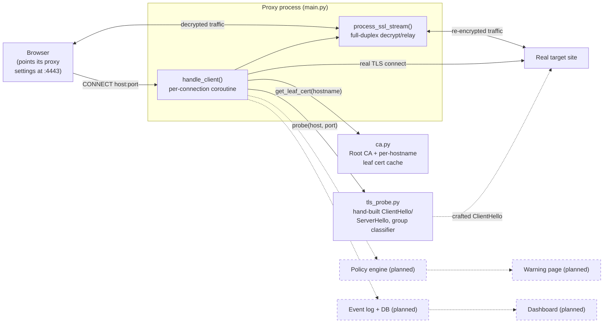
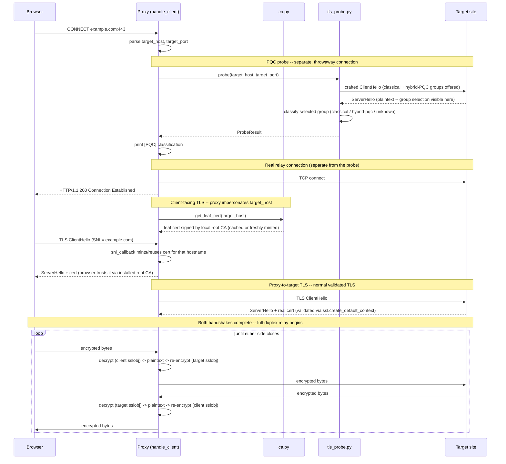
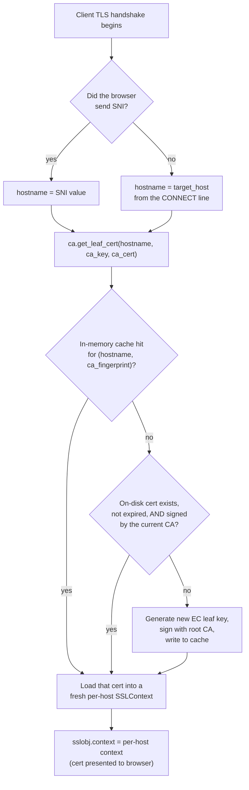

# System Flow

This reflects what's actually implemented right now (`main.py`, `ca.py`, `tls_probe.py` +
`tests/`). Pieces we've discussed but haven't built yet (policy engine, warning interstitial,
dashboard, persistence) are marked *(planned)* and shown dashed.

## 1. Components

## 2. Per-connection sequence (what happens for one site the browser visits)

## 3. Dynamic certificate selection (`build_client_ssl_context`)

## 4. PQC group detection (`tls_probe.probe`)

```mermaid
flowchart TD
    A["build_client_hello(hostname)"] --> B["Offer groups:\nx25519, secp256r1 (classical)\nX25519MLKEM768 (hybrid-pqc)"]
    B --> C["Real key material per group:\ncryptography (EC/X25519)\nkyber-py (ML-KEM-768)"]
    C --> D["Send raw ClientHello\nover a plain TCP socket"]
    D --> E{"First record type?"}
    E -- "Alert" --> F["ProbeResult(error=...)"]
    E -- "Handshake" --> G["Accumulate until full\nServerHello received"]
    G --> H["Read selected cipher suite\n+ key_share group ID\n(sent in plaintext)"]
    H --> I["classify_group(group_id)"]
    I --> J["ProbeResult:\nclassical / hybrid-pqc / unknown"]

    style F fill:#3a1f1f
```

## Known limitation (by design, for now)

The probe offers PQC groups, but the *real relay connection* to the target (step in section 2)
still uses plain stdlib `ssl` (classical only) — it only needs to work, not to detect anything.
Only the throwaway probe connection tests PQC support. Also: since this machine's OpenSSL is
3.0.15, our own probe's classical groups are real, but a target that *only* speaks TLS 1.2 or
earlier will simply fail our TLS-1.3-only probe with a handshake alert rather than being
misclassified — this shows up as `error`, not a false "classical" result.
